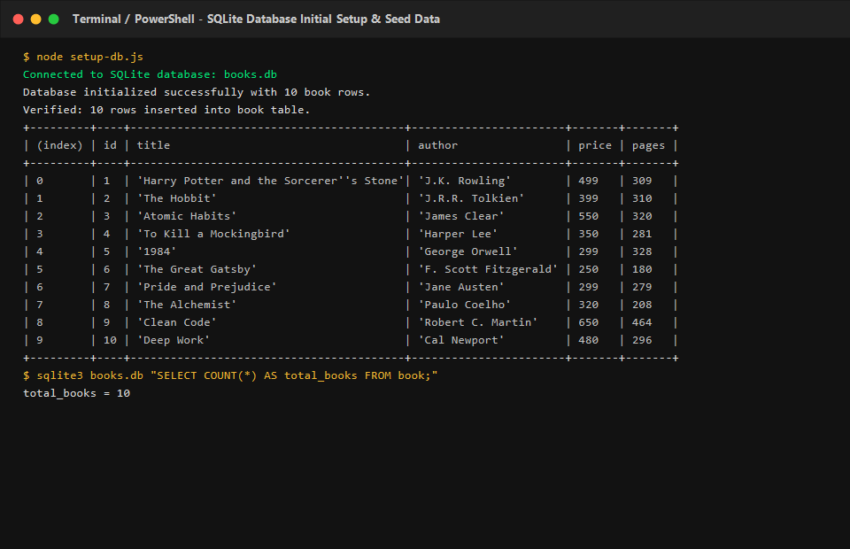
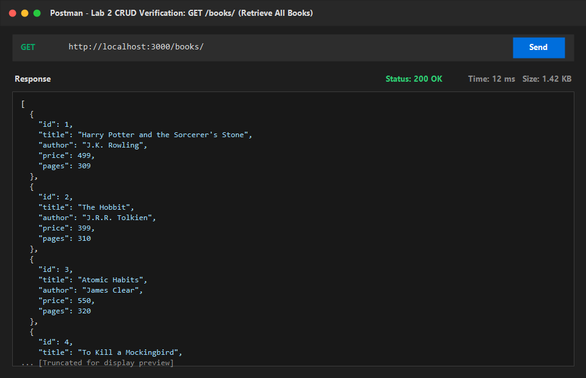
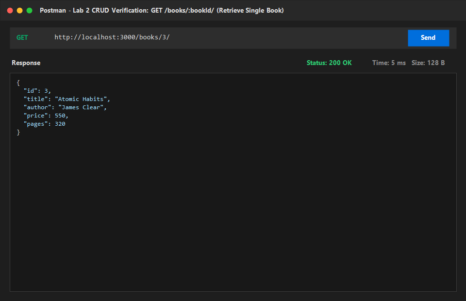
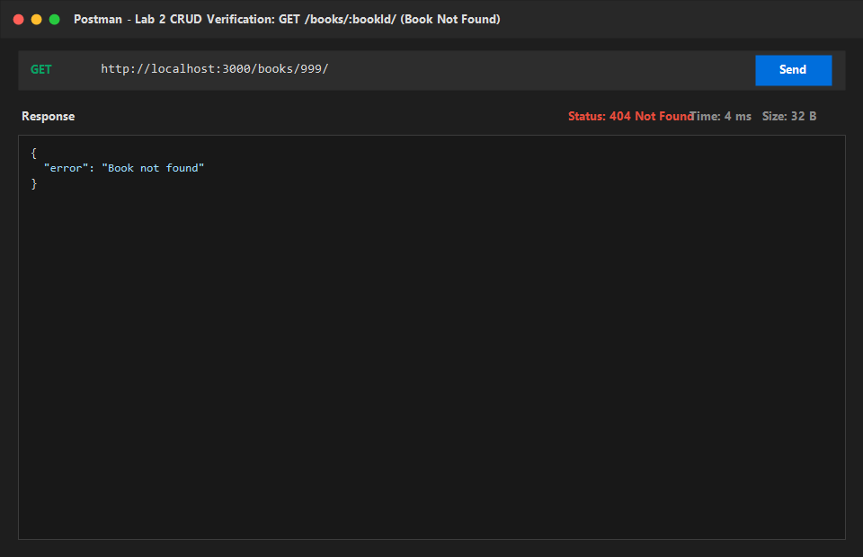
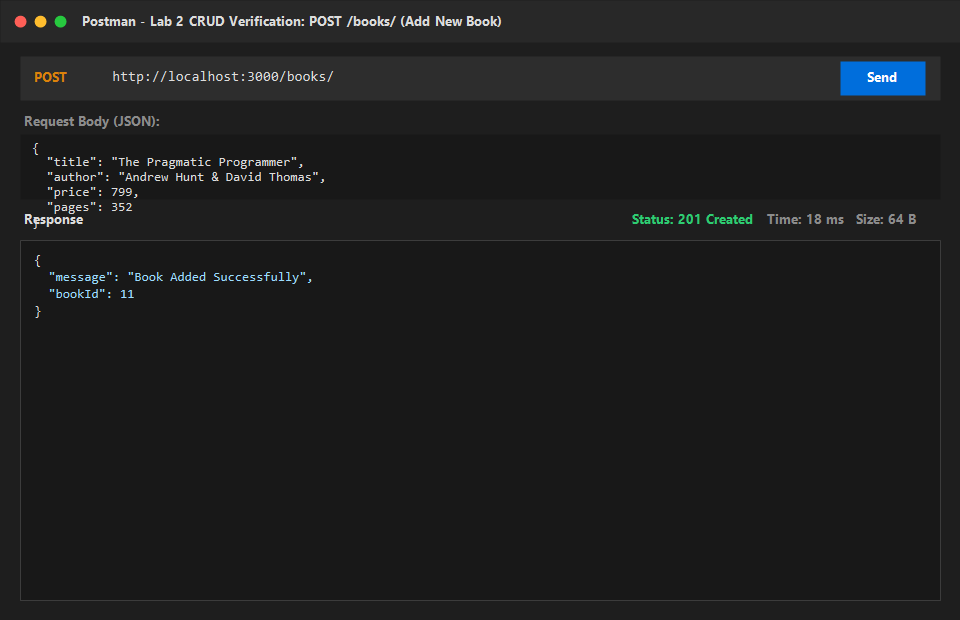
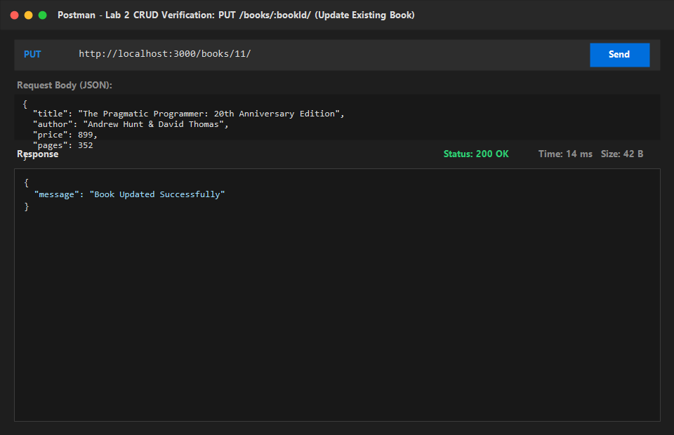
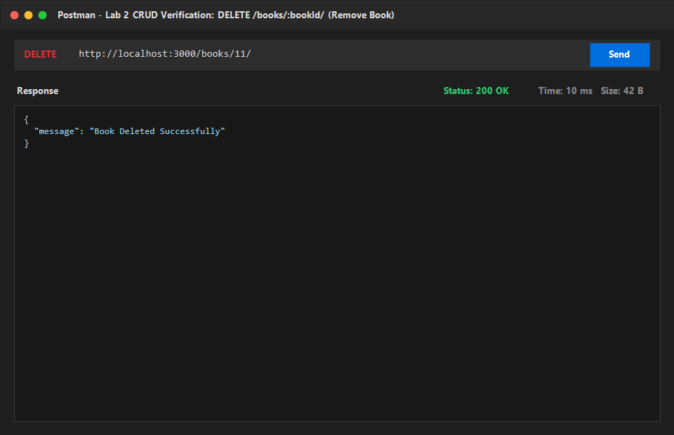
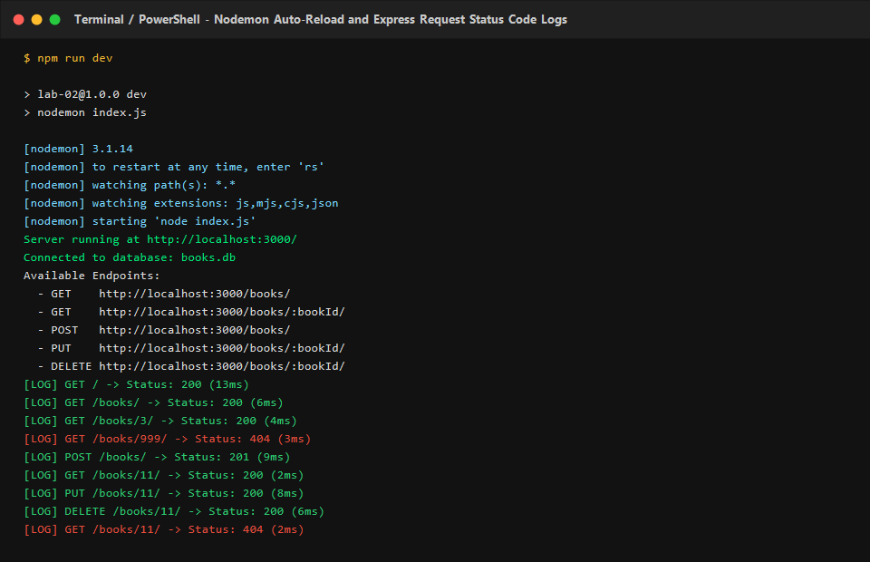

# Lab 2: SQLite database and CRUD routes

**Student Name:** Kollampally Sai Nihal  
**Registration Number:** 252U1R6104  
**Section:** AIML-IB  
**Course:** Backend Development Fundamentals · Year II Term II  
**Institution:** Aurora  
**Faculty:** Joel Prashanth D  

---

## Live Link
- **Deployment URL:** `Not applicable (Local execution / Ready for deployment on Render, Railway, or NxtWave Cloud IDE)`
> *Note:* In cloud environments with ephemeral filesystems (such as free-tier Render or Railway without persistent disks), SQLite file modifications are reset on container restart. Postman test outputs, terminal status logs, and database verification screenshots are documented in detail below.

---

## How to Run

### 1. Prerequisites
- **Node.js** (v18.x or newer, verified on v24.15.0)
- **npm** (v9.x or newer, verified on v11.12.1)
- **SQLite3** (CLI or Node `sqlite3` driver)

### 2. Installation
Navigate into the `lab-02` directory and install project dependencies:
```bash
cd lab-02
npm install
```

Installed packages:
- `express`: Minimalist web framework for Node.js
- `sqlite`: Modern Promise-based async wrapper for SQLite3
- `sqlite3`: Native SQLite3 driver engine
- `dotenv`: Loads environment variables from `.env`
- `nodemon` *(devDependency)*: Auto-restarts server on source file changes

### 3. Environment Variables
Create a `.env` file in the root of `lab-02/` based on `.env.example`:
```bash
PORT=3000
```
*(Never commit the real `.env` file to version control. It is ignored by `.gitignore`.)*

### 4. Database Setup & Initialization (Task 2)
The database file `books.db` comes pre-populated with 10 book records. If you ever need to reset or recreate the database from scratch, run:
```bash
npm run init-db
```
Or manually via SQLite CLI:
```bash
sqlite3 books.db < setup.sql
```

### 5. Start Commands (Task 1 & Task 3)

#### Run with Nodemon (Auto-restarts on change)
```bash
npm run dev
```

#### Run with Standard Node.js
```bash
npm start
```

---

## Endpoints Table

| HTTP Method | Route | Description | Expected Status Code | Request Body | Response Format |
|---|---|---|---|---|---|
| `GET` | `/` | API overview and student metadata | `200 OK` | None | JSON object |
| `GET` | `/books/` | Retrieves all books ordered by ID | `200 OK` | None | JSON array of book objects |
| `GET` | `/books/:bookId/` | Retrieves a specific book by ID | `200 OK` / `404 Not Found` | None | Single book object or error JSON |
| `POST` | `/books/` | Adds a new book to the database | `201 Created` / `400 Bad Request` | `{ "title", "author", "price", "pages" }` | `{ "message": "Book Added Successfully", "bookId": 11 }` |
| `PUT` | `/books/:bookId/` | Updates an existing book by ID | `200 OK` / `404 Not Found` | `{ "title", "author", "price", "pages" }` | `{ "message": "Book Updated Successfully" }` |
| `DELETE` | `/books/:bookId/` | Removes a book by ID | `200 OK` / `404 Not Found` | None | `{ "message": "Book Deleted Successfully" }` |

---

## Scripts Table

| Script Name | Command | Purpose |
|---|---|---|
| `npm start` | `node index.js` | Runs Express server in standard Node environment |
| `npm run dev` | `nodemon index.js` | Runs Express server with nodemon auto-restart on code change |
| `npm run init-db` | `node setup-db.js` | Initializes `books.db` with table schema and 10 seed rows |

---

## Screenshots

### 1. Database Initialization & Seed Data (Task 2)
Database file `books.db` initialized with 10 rows inserted into the `book` table:


### 2. GET All Books (`GET /books/`) (Task 4)
Fetches all 10 books from the database with status `200 OK`:


### 3. GET Single Book (`GET /books/3/`) (Task 4)
Fetches "Atomic Habits" (ID: 3) with status `200 OK`:


### 4. GET Book Not Found (`GET /books/999/`)
Queries nonexistent ID 999 and returns `{ "error": "Book not found" }` with status `404 Not Found`:


### 5. POST Add Book (`POST /books/`) (Task 4)
Inserts "The Pragmatic Programmer" into the database with status `201 Created` and returns new ID `11`:


### 6. PUT Update Book (`PUT /books/11/`) (Task 4)
Updates price and edition for book ID 11 with status `200 OK`:


### 7. DELETE Remove Book (`DELETE /books/11/`) (Task 4)
Deletes book ID 11 from the database with status `200 OK`:


### 8. Nodemon Auto-Reload and Terminal Logs (Task 1 & Task 3)
Nodemon watching for file edits, server starting via `initializeDBAndServer()`, and request status code logging:


---

## Notes: Problems Faced and How You Solved Them

1. **Ensuring Database Connects Before Starting the HTTP Server:**
   - *Problem:* If `app.listen()` executes before the SQLite database connection completes, incoming HTTP requests crash because `db` is still `null`.
   - *Solution:* Implemented an async `initializeDBAndServer()` function that executes `db = await open(...)` and only starts `app.listen(PORT, ...)` inside the `try` block after the connection promise successfully resolves. If the connection fails, it catches the error and exits gracefully (`process.exit(1)`).

2. **Preventing Silent Failures in PUT and DELETE for Nonexistent IDs:**
   - *Problem:* By default, running a SQLite `UPDATE` or `DELETE` query on an `id` that does not exist in the database completes with zero affected rows without throwing an error, which could mislead the API consumer into thinking a nonexistent book was updated or deleted.
   - *Solution:* Added pre-flight check queries (`SELECT id FROM book WHERE id = ?;`) inside both `PUT /books/:bookId/` and `DELETE /books/:bookId/`. If the record is not found, the endpoint returns HTTP status `404 Not Found` with `{ "error": "Book not found" }`.

3. **Preventing SQL Injection Vulnerabilities:**
   - *Problem:* Concatenating user inputs directly into SQL strings (e.g., `WHERE id = ${bookId}`) allows attackers to execute arbitrary SQL commands (SQL Injection).
   - *Solution:* Used parameterized queries with `?` placeholders throughout all routes (`db.get()`, `db.run()`, `db.all()`). The database driver securely sanitizes and escapes all bound arguments before query evaluation.

4. **Nodemon Hot-Reloading Configuration:**
   - *Problem:* Server needed manual stopping and restarting upon every route change during development.
   - *Solution:* Configured nodemon as a devDependency with `"dev": "nodemon index.js"` in `package.json`, allowing instant hot-reload on every file save.

---

## Viva Questions & Answers

### 1. Why await the database call?
Database I/O operations (such as opening connections, querying records with `SELECT`, or persisting changes with `INSERT`/`UPDATE`/`DELETE`) are asynchronous because they involve reading from and writing to disk.

- Node.js runs on a single-threaded event loop. If database calls were synchronous and blocking, the entire server thread would freeze while waiting for the disk I/O to finish, blocking all other incoming HTTP requests.
- Using `await` suspends execution of the enclosing `async` function until the database Promise resolves, without blocking the Node.js event loop.
- Awaiting `initializeDBAndServer()` guarantees that the SQLite database file and tables are fully accessible before the HTTP server begins accepting requests.

### 2. What is SQL injection and how do placeholders prevent it?
**SQL Injection (SQLi)** is a cybersecurity vulnerability that occurs when untrusted user input is directly concatenated or interpolated into a raw SQL query string. An attacker can craft malicious inputs containing SQL syntax (e.g. `' OR '1'='1'; DROP TABLE book; --`) to manipulate the query structure, bypass authentication, expose sensitive data, or delete tables.

**How placeholders (`?`) prevent it:**
- When using placeholders (`?`), the SQL statement structure is pre-compiled by the database engine first.
- The input values are sent separately from the SQL statement as parameters.
- The database engine treats parameter values strictly as literal data (values), never as executable SQL code, regardless of whether the input contains quotes, semicolons, or SQL keywords.

### 3. When is PUT used instead of POST?
| Feature | `POST` | `PUT` |
|---|---|---|
| **Primary Purpose** | Creates a new subordinate resource. | Replaces / updates an existing resource (or creates at a known URI). |
| **Idempotency** | **Non-Idempotent:** Repeating the request multiple times creates multiple duplicate resources (e.g., creates book ID 11, then 12, then 13). | **Idempotent:** Repeating the request multiple times produces the exact same end state (the resource at `/books/11/` remains identically updated). |
| **URI Target** | Sent to a collection endpoint (e.g., `POST /books/`). | Sent to a specific resource URI (e.g., `PUT /books/:bookId/`). |
| **HTTP Status Code** | Typically returns `201 Created` upon success. | Typically returns `200 OK` (or `204 No Content`) upon success. |
