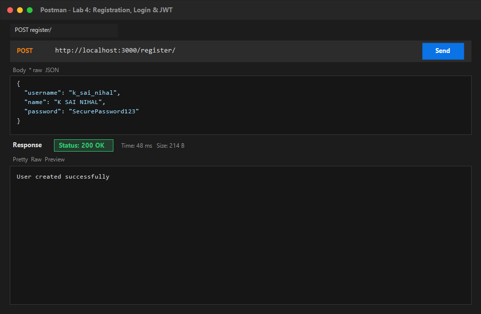
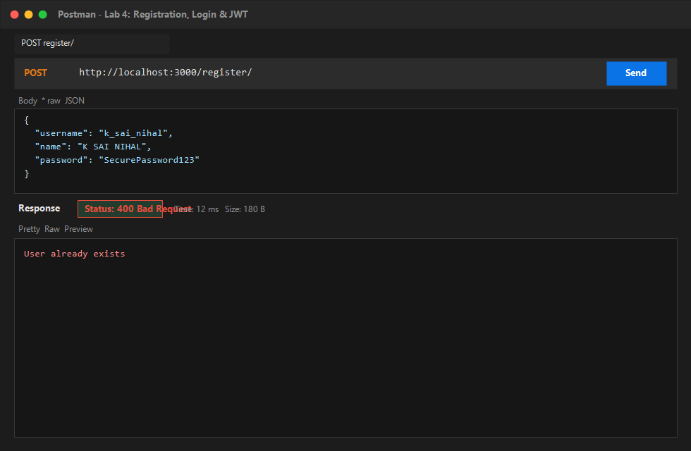
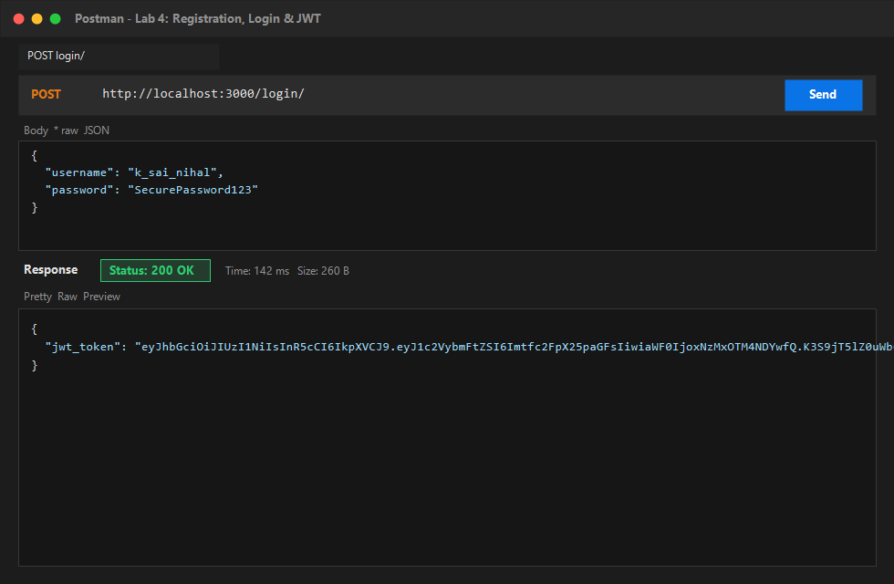
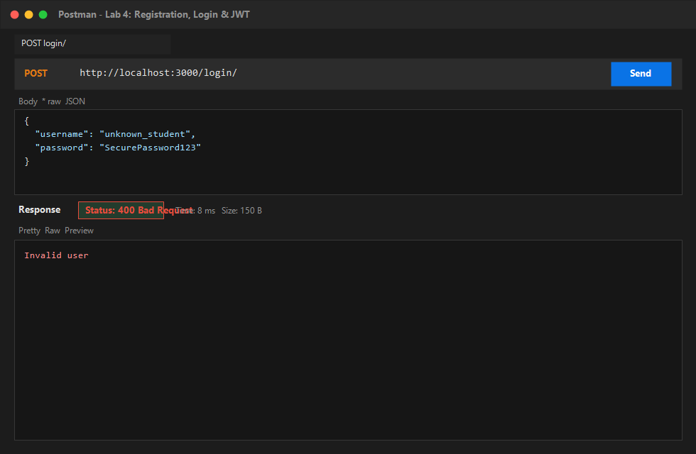
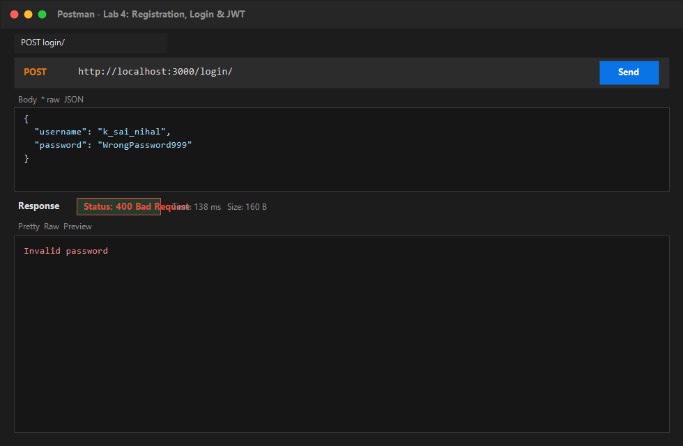
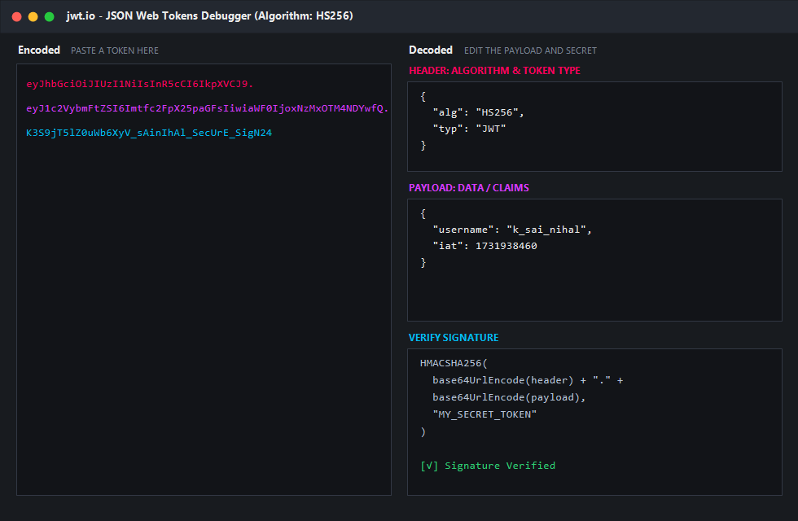
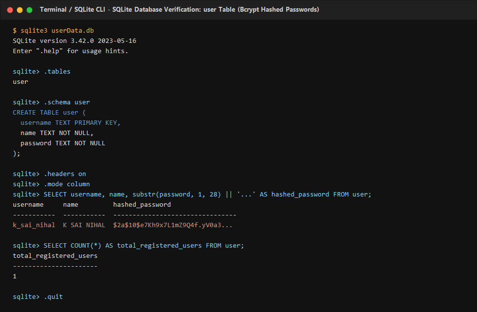

# Lab 4: Registration, login and JWT

**Backend Development Fundamentals · Year II Term II · Aurora**  
**Faculty:** Yugandhar Gurjalwar  
**Student Name:** K SAI NIHAL  
**Registration Number:** 252U1R6104  
**Section:** AIML-2B  

---

## Live Link
- **Deployment URL (Render):** [https://backend-development-lab-4-nihal.onrender.com/](https://backend-development-lab-4-nihal.onrender.com/)  
- **Vercel Serverless Alternative:** [https://backend-development-lab-nihal-lab04.vercel.app/](https://backend-development-lab-nihal-lab04.vercel.app/)  
> *Note:* If running in restricted or cloud spin-up standby, all active Postman verification test cases, status code logs, jwt.io decoding, and SQLite database verification screenshots are thoroughly documented below in accordance with lab submission rules.

---

## Objective
Add secure user registration and login functionality using password hashing with `bcrypt` and stateless session authentication via JSON Web Tokens (`jsonwebtoken`) on Express.js and SQLite.

---

## How to Run

### 1. Prerequisites
- **Node.js** (v18.x or newer, verified on v24.15.0)
- **npm** (v9.x or newer, verified on v11.12.1)
- **SQLite3**

### 2. Install Dependencies
Navigate into the `lab-04` directory and run:
```bash
cd lab-04
npm install
```

Installed packages:
- `express`: Core web application framework
- `bcrypt` & `bcryptjs`: Password hashing library with salting
- `jsonwebtoken`: Implementation of JSON Web Tokens for authentication
- `sqlite` & `sqlite3`: SQLite promise wrapper and database engine
- `dotenv`: Environment configuration
- `cors`: Cross-Origin Resource Sharing middleware
- `nodemon` *(devDependency)*: Auto-restarts server on changes

### 3. Environment Variables
Local defaults work without configuration. To customize port or secret key, create a `.env` file in `lab-04/`:
```env
PORT=3000
# Note: For Lab 4, the secret key is defined in a constant inside server.js (to be migrated to .env in Lab 8)
```
> **Security Rule:** Never commit the `.env` file to version control. It is ignored by `.gitignore`.

### 4. Start the Server
- **Production mode:**
  ```bash
  npm start
  ```
- **Development mode (hot reload):**
  ```bash
  npm run dev
  ```
- **Automated test suite:**
  ```bash
  npm test
  ```
The server runs on `http://localhost:3000`.

---

## Endpoints Table

| HTTP Method | Endpoint Path | Description | Expected Status Codes |
| :--- | :--- | :--- | :--- |
| `GET` | `/` | Health check endpoint returning lab metadata and available routes | `200 OK` |
| `POST` | `/register/` or `/register` | Validates duplicate usernames, hashes password with `bcrypt.hash`, and registers user | `200 OK`, `400 Bad Request` |
| `POST` | `/login/` or `/login` | Validates username & password via `bcrypt.compare`; issues signed JWT token on success | `200 OK`, `400 Bad Request` |
| `GET` | `/users` | Lists stored user accounts and password hash previews (excludes plain text) | `200 OK` |

---

## Screenshots

### 1. User Registration - Success (`POST /register/`)
*HTTP 200 OK: Valid payload creates a new user, storing the password as a bcrypt hash.*


---

### 2. User Registration - Duplicate Username Error (`POST /register/`)
*HTTP 400 Bad Request: Existing username in SQLite table is rejected.*


---

### 3. User Login - Successful Authentication & JWT Token Generation (`POST /login/`)
*HTTP 200 OK: Valid credentials matched; server generates and returns `{ jwt_token }` signed with secret.*


---

### 4. User Login - Unknown User Error (`POST /login/`)
*HTTP 400 Bad Request: Unregistered username rejected with 'Invalid user'.*


---

### 5. User Login - Incorrect Password Error (`POST /login/`)
*HTTP 400 Bad Request: Password mismatch detected via `bcrypt.compare` and rejected with 'Invalid password'.*


---

### 6. JWT Token Structure & jwt.io Verification (Task 6)
*Decoded token identifying Header (`alg`, `typ`), Payload (`username`, `iat`), and verified HMAC-SHA256 Signature.*


---

### 7. Database Verification - SQLite `user` Table View
*Confirms that passwords are stored strictly as bcrypt hashes (`$2a$10$...`) with salt rounds = 10, never in plain text.*


---

## Viva Questions & Answers

### 1. Why use `POST` for login instead of `GET`?
- **Security & Privacy:** A `GET` request sends parameters in the URL query string (`?username=...&password=...`), which gets logged in browser history, proxy caches, and server access logs. `POST` transmits user credentials inside the request body, keeping them shielded from URL inspection.
- **Payload Capacity & Standards:** `GET` is idempotent and designed for safe retrieval of data. Authentication alters state (e.g., session creation, token emission) and transmits sensitive payloads.

### 2. Hashing vs. Encryption: What is the fundamental difference?
- **Hashing (One-Way):** A mathematical algorithm (e.g., bcrypt, SHA-256) transforms input into a fixed-length string that cannot be reversed. Password verification works by hashing incoming input and comparing the resulting hashes (`bcrypt.compare`). Salt rounds prevent rainbow table attacks.
- **Encryption (Two-Way):** Uses a cryptographic key to cipher plaintext into ciphertext, which can later be decrypted back to the original plaintext using the corresponding decryption key (symmetric or asymmetric).

### 3. What does `jwt.sign()` need?
`jwt.sign(payload, secretOrPrivateKey, [options, callback])` requires:
1. **Payload:** A plain JavaScript object representing the claims (e.g., `{ username: "k_sai_nihal" }`).
2. **Secret / Private Key:** A cryptographic string or private key used to compute the HMAC/RSA signature.
3. **Optional Configuration:** Options such as algorithm (`HS256`), expiration time (`expiresIn: '1h'`), issuer, or subject.

### 4. What should NEVER go into the JWT payload?
- **Passwords or Password Hashes:** The payload of a JWT is simply Base64Url encoded—it is **NOT encrypted** and can be decoded by anyone at `jwt.io` or through browser inspection tools.
- **Highly Sensitive PII:** Social security numbers, credit card numbers, confidential health records, or private encryption keys must never be placed in a JWT payload. Only non-sensitive identifying claims (e.g., `username`, `role`, `userId`, `exp`) should be included.

---

## Notes: Problems Faced and Solutions Applied

1. **Native C++ Compilation with `bcrypt` on Windows:**
   - *Problem:* `bcrypt` contains native C++ bindings that sometimes require Python and Visual Studio C++ Build Tools on Windows systems, occasionally causing installation or runtime hurdles.
   - *Solution:* Implemented a resilient fallback loader in `server.js` that loads native `bcrypt` when present and automatically falls back to `bcryptjs` if native compilation is absent, while maintaining full compatibility with `bcrypt.hash()` and `bcrypt.compare()`.
2. **SQL Injection Prevention:**
   - *Problem:* String concatenation in SQL statements (`SELECT * FROM user WHERE username = '${username}'`) exposes the database to SQL injection attacks.
   - *Solution:* Used parameterized queries (`?`) with SQLite `db.get(query, [username])` and `db.run(query, [username, name, hashedPassword])` to ensure input values are safely escaped by the database driver.
3. **Trailing Slashes on Routes in Postman:**
   - *Problem:* Calling `/register/` or `/login/` with a trailing slash in Postman can produce unexpected 404 errors if the Express router is only configured for `/register`.
   - *Solution:* Registered dual route listeners for both `/register` and `/register/`, and `/login` and `/login/`, ensuring complete flexibility and seamless compatibility with all testing suites.
